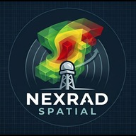

# Nexrad Spatial

Nexrad Spatial is an immersive, fully 3D volumetric weather radar and data visualization application built on top of Unreal Engine 5.7. It allows you to step inside extreme weather events, view raw radar sweeps from across the globe in breathtaking 3D detail, and analyze live atmospheric data dynamically in Virtual Reality.

## Releases

**Version 1.02** is now officially released and completely free to download! Precompiled binaries can be found directly on the GitHub [Releases](https://github.com/Trancsfict8/Openstorm-VR/releases) page.

For more information, visit our website at [NexradSpatial.com](https://NexradSpatial.com) or join the community on the [Nexrad Spatial Discord Server](https://discord.gg/RHXm935w7s).

---

## How to Use

### Getting Started
1. Download the latest build from the [Releases](https://github.com/Trancsfict8/Openstorm-VR/releases) section.
2. Extract the archive and launch `NexradSpatial.exe`.
3. Works out of the box with OpenXR-compatible VR headsets (Meta Quest via Link/AirLink/Virtual Desktop, Valve Index, HTC Vive, WMR) or in desktop mode.

---

### Controls

#### Virtual Reality (VR)
* **Left Controller**:
  * **Thumbstick**: Move forward/backward & strafe left/right.
  * **Trigger**: Fly upwards (ascend).
  * **Grip**: Fly downwards (descend).
  * **Menu Button**: Toggle the interactive VR menu tablet.
  * **X Button (Hold) + Right Thumbstick**: Adjust distance of the 3D inspector probe.
* **Right Controller**:
  * **Thumbstick (Left / Right)**: Rotate camera view.
  * **Thumbstick (Up / Down)**: Scroll VR menus.
  * **Thumbstick (Click)**: Toggle 3D Inspector Probe (samples live dBZ inside storm cores).
  * **Trigger**: Interact with menus, click warning polygons, or draw in 3D.
  * **A Button (Hold 1.0s)**: Spatial Interrogator (extracts GPS coordinates & street location).
  * **A Button (Press)**: Remove last marker.
  * **B Button (Press)**: Toggle 3D drawing tool.
  * **B Button (Hold) + Trigger**: Erase drawn line. Hold B for 3 seconds to clear all lines.

#### Desktop Mode
* **W / A / S / D** (or Arrow Keys): Fly forward, backward, left, and right.
* **E / Q**: Ascend / Descend.
* **Left Shift**: Speed boost.
* **Mouse**: Look and rotate view (hold Right Click to look).
* **Left Click**: Select options and interact with UI.

---

### Key Features & Workflow

* **Selecting Radar Sites (GPS Tab)**:
  Browse and select any NEXRAD station across the United States to teleport directly to that radar's geographic location.
* **Live Radar & Archive Playback (Radar & Archive Tabs)**:
  * Enable **Live Data** and **Auto-Poll** to stream current Level 2 and Level 3 radar sweeps in real time.
  * Use the **Archive** tab to download and step through historical severe weather events.
  * Use playback controls (`<< Step`, `Play/Pause`, `Step >>`) to animate radar volume progressions.
* **Products & Render Modes**:
  * Switch between products including Base Reflectivity, Radial Velocity, and Normalized Rotation.
  * Toggle between full **3D Volume** raymarching and **2D Slice** views (with adjustable slice altitude, tilt angle, and vertical rotation).
* **Storm Attributes & Weather Warnings**:
  * View real-time Level 3 storm tracking markers: purple cones for Tornado Vortex Signatures (TVS) and green spheres for Hail Index.
  * Point and click on National Weather Service (NWS) warning polygons to inspect full weather bulletin advisories.
* **Spatial Weather Audio**:
  Dynamic binaural audio spatializes severe storm cores and rain envelopes around you as you fly through weather systems.

---

## Open Source Credits

This project is a heavily expanded derivative work of the open-source **OpenStorm Radar** project (originally developed by Jordan Schlick). In accordance with the GPLv2 license, the core radar ingestion, binary decoding, and processing architecture utilized within this application are fully open-source.

* **OpenStorm Base Framework:** Copyright (c) Jordan Schlick & Contributors.
* **Nexrad Spatial Modifications:** Copyright (c) 2026 Nexrad Spatial.

*If you are interested in the original desktop application without the VR ecosystem modifications, check out the original [OpenStorm repository on GitHub](https://github.com/JordanSchlick/OpenStorm).*